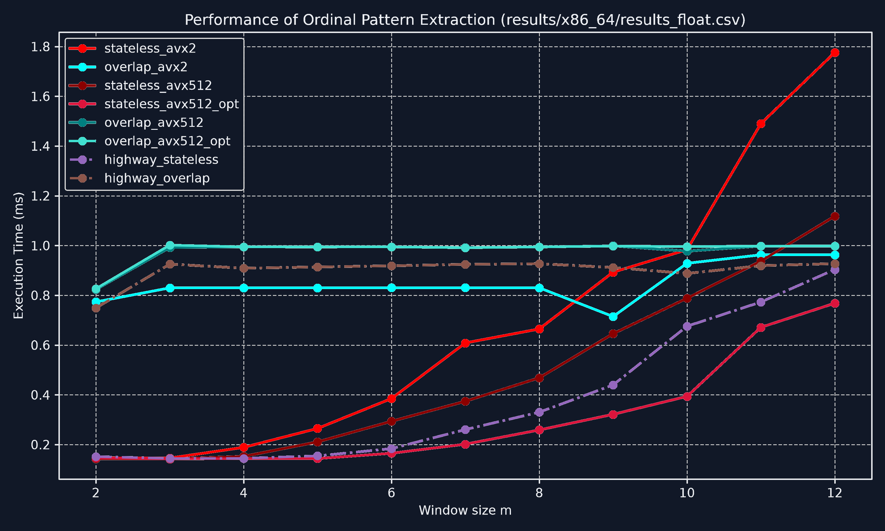
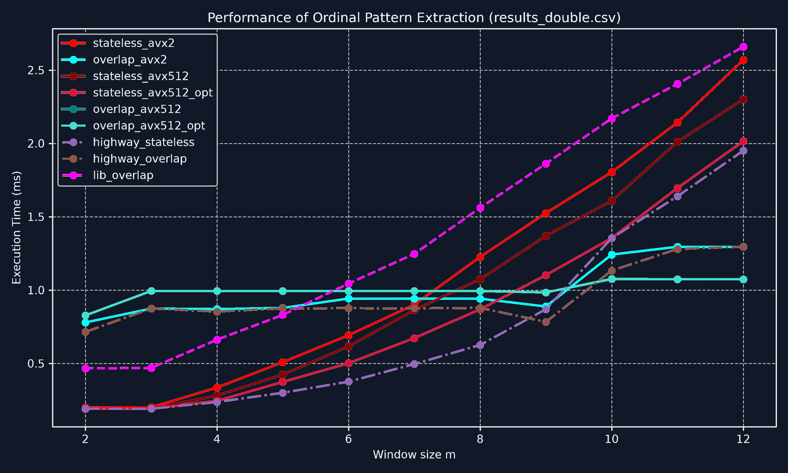
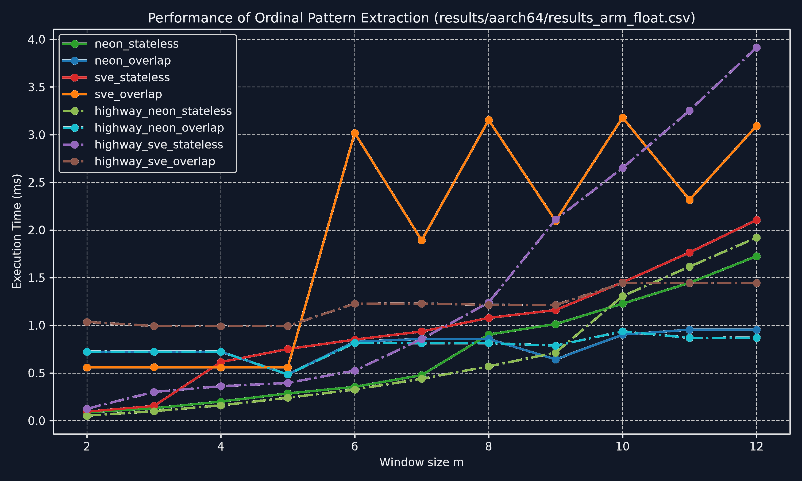
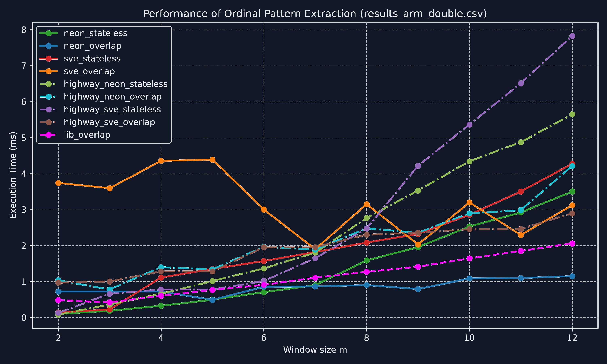

# vlibordpat: High-Performance SIMD Ordinal Pattern Extraction

> **NOTE**: This repository serves as a public overview of a private project. The source code, algorithms, and implementation details are maintained in a separate, closed repository. **For access to the source code, please see the [Source Code Access](#-source-code-access) section below.**

`vlibordpat` is a vectorized library and benchmark suite for extracting **ordinal patterns** (permutation patterns) from continuous time-series data [[1]](#references). It is engineered for low-latency financial signal processing, non-linear biomedical analysis (EEG/ECG complexity, permutation entropy), and real-time dynamical systems monitoring. By deploying both **Stateless Vertical** and **Overlap Horizontal** vectorization strategies, it delivers up to an order-of-magnitude speedup over canonical scalar algorithms.

---

## 🔒 Source Code Access

I am happy to grant you read-only access to the private repository containing the full implementation, tests, and benchmark suites. Please reach out to me via **[Direct Message on LinkedIn](https://www.linkedin.com/in/rafa%C5%82-abram-91509670/)** with your GitHub username to receive an invitation.

---

## 1. Optimization Results

The private repository includes automated benchmark runners that evaluate performance across different precision types and architectures. Below are the generated results:

### x86-64 Architecture

| Single-Precision (`float`) | Double-Precision (`double`) |
| :---: | :---: |
|  |  |

### AArch64 Architecture

| Single-Precision (`float`) | Double-Precision (`double`) |
| :---: | :---: |
|  |  |

---

## 2. Mathematical Justification of $m \le 12$

`vlibordpat` explicitly bounds supported pattern orders to $m \in [2..12]$ based on strict factoradic representation limits:

### Factoradic Representation & 32-bit Integer Limits
An ordinal permutation of order $m$ represents one of $m!$ states:
$$
\begin{aligned}
12! &= 479{,}001{,}600 < 2^{32} - 1 = 4{,}294{,}967{,}295 \\
13! &= 6{,}227{,}020{,}800 > 2^{32} - 1
\end{aligned}
$$
- For all $m \le 12$, both intermediate rank multipliers and final ordinal codes fit losslessly into compact **32-bit unsigned integer registers** (`uint32_t`).
- Supporting $m \ge 13$ necessitates 64-bit multi-word arithmetic (`FactorialWeights64`), halving SIMD vector register density, doubling memory traffic, and severely degrading hardware cache performance.

---

## 3. Acknowledgments & References

### References
1. Bandt, C., & Pompe, B. (2002). Permutation Entropy: A Natural Complexity Measure for Time Series. *Physical Review Letters*, 88(17), 174102. [DOI: 10.1103/PhysRevLett.88.174102](https://doi.org/10.1103/PhysRevLett.88.174102)

### Third-Party Software & Attribution
This project builds upon and benchmarks against the following excellent open-source work:

- **[libordpat](https://github.com/seb-berger/libordpat)**: Canonical reference implementation for ordinal pattern extraction by Sebastian Berger, used under the BSD 3-Clause License.
- **[Google Highway](https://github.com/google/highway)**: Efficient and portable SIMD C++ library by Google LLC, used under the Apache 2.0 / BSD 3-Clause License.